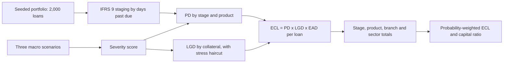

# SACCO Stress Test: IFRS 9 expected credit loss for a Kenyan SACCO under three economic scenarios

**A Python engine that stress-tests a Kenyan SACCO loan book under base, adverse and severely adverse
scenarios and reports IFRS 9 expected credit loss by stage, product, branch and sector. On a seeded synthetic
portfolio of 2,000 loans worth KES 231.9M, expected credit loss rises from KES 1.81M in the base case to KES
19.27M in the severe scenario, taking the capital ratio from 14.2% to 6.7%, KES 7.68M short of a 10% minimum.
A test proves a fresh run reproduces every figure on this page.**

[](LICENSE)
[](https://github.com/alvenyuka/SACCO-Stress-Test/actions/workflows/ci.yml)


## The problem

A Kenyan SACCO lends its members' savings back to them, so a downturn that raises defaults eats directly into
members' capital. Its board and its regulator need to know, before the downturn arrives, how much it would
have to provision under IFRS 9 and whether its capital would stay above the minimum. The question: **how much
expected credit loss would a drought-and-inflation shock add to a typical SACCO loan book, and would capital
survive it?**

## How it works



1. **Portfolio.** `PortfolioGenerator` (seed 42) builds 2,000 loans across five products (Emergency,
   Development, School Fees, Business, Asset Finance), ten branches and nine borrower sectors, with loan size
   linked to income and interest rates and terms set by product.
2. **Staging.** Each loan is placed in IFRS 9 Stage 1, 2 or 3 from its days past due and status: over 30 days
   or restructured is Stage 2; over 90 days, defaulted or written off is Stage 3.
3. **Scenarios.** Base, Adverse and Severely Adverse set GDP growth (+5% to -1.5%), inflation (6.5% to 14%), the
   central bank rate (10% to 16%), unemployment, shilling depreciation (3% to 25%) and an agricultural shock (0% to
   -30%). Each scenario is summarised as one severity score.
4. **Probability of default.** A base PD by stage and product is raised by 8% for each severity point, by up to
   30% for borrowers whose loan exceeds half their income, and by a sector shock: agriculture under a drought,
   trade and transport under a weak shilling. PD is capped at 99%.
5. **Loss given default and exposure.** LGD is 65% unsecured, 45% partially secured and 25% fully secured,
   raised by 3% for each severity point as collateral values fall, capped at 95%. EAD is the outstanding
   balance.
6. **Reporting.** ECL per loan, totals by stage, product, branch and sector, the probability-weighted ECL, the
   capital ratio after losses, a console report and a four-sheet Excel workbook.

## Stack

| Layer | Tool | Version |
|---|---|---|
| Language | Python | CI on 3.12 and 3.13 |
| Engine | NumPy, standard-library dataclasses | 2.4.6 |
| Workbook output | openpyxl | 3.1.5 |
| Charts | matplotlib | 3.9.2 |
| Tests and CI | pytest, GitHub Actions | |

## Results

- 2,000 synthetic loans, KES 231.9M outstanding, generated from seed 42.
- 3 scenarios weighted 60%, 30% and 10%.
- 5 tests pass, including one that re-runs the engine and compares every figure with `outputs/results.json`.

| Scenario | Weight | Severity score | ECL | Provision rate | Capital ratio after losses |
|---|---|---|---|---|---|
| Base Case | 60% | 2.4 | KES 1.81M | 0.78% | 14.2% |
| Adverse | 30% | 27.1 | KES 8.08M | 3.49% | 11.5% |
| Severely Adverse | 10% | 57.0 | KES 19.27M | 8.31% | 6.7%, below the 10% minimum |
| Probability-weighted | | | KES 5.44M | 2.35% | |

The probability-weighted figure is the one IFRS 9 asks for: 60% of the base-case loss, 30% of the adverse and 10%
of the severe. Every figure in this section is written to `outputs/results.json` by `make_figures.py`.

## Business impact

Under the severe scenario the SACCO would need **KES 7.68M of extra capital** to stay at a 10% capital ratio
after losses. The provision a board would book today, the probability-weighted ECL, is KES 5.44M, three times
the base-case figure of KES 1.81M: a SACCO that provisions only for the expected economy is under-provisioned
against the range of economies it could face.

Assumptions: equity equals 15% of outstanding loans before losses; the capital ratio uses loans, not
risk-weighted assets, as the denominator; the 10% minimum is the test threshold.

## Charts


*Under the adverse scenario agriculture carries the highest provision rate (4.52% of outstanding), from the
drought shock applied to farm incomes; services and manufacturing are lowest at 2.94%.*

The first chart, at the top of this page, shows ECL and the capital ratio side by side for each scenario: the
step from adverse to severe costs more capital than the step from base to adverse.

## Data

| Source | Link | Terms | Size | Period | Refresh |
|---|---|---|---:|---|---|
| Synthetic portfolio from `PortfolioGenerator` | `stress_test_engine.py` | MIT, this repository | 2,000 loans, KES 231.9M | point in time | regenerated on each run, seed 42 |

No real SACCO or member data is used. Branch names are Kenyan towns and member names are generic Kenyan
names chosen to make the reports readable.

## Key design decisions

- **Probability-weighted ECL rather than the base case.** IFRS 9 requires an unbiased, probability-weighted
  estimate across a range of outcomes, so the engine reports the weighted figure as the provision and the
  scenarios as the stress.
- **One severity score per scenario.** Six macro variables collapse into one score that drives PD and LGD
  together, so a reader can see why each scenario costs what it does.
- **Sector shocks tied to the macro variable that hits them.** Agriculture responds to the drought variable
  and trade and transport to the shilling, rather than one shock for every borrower.
- **Collateral reduces loss, and stress reduces collateral.** LGD depends on how well a loan is secured, and the
  haircut grows with severity, because forced-sale values fall in a downturn.
- **A seeded generator and a reproduction test.** The same seed always gives the same portfolio, and a test
  fails if a fresh run no longer matches the committed results.

## Limits

- **The portfolio is synthetic.** The figures show how the engine behaves, not the condition of any real lender.
- **The parameters are illustrative.** Stage PDs, LGDs, the severity multipliers and the scenario values are set
  by hand, not fitted to historical SACCO defaults or taken from a regulator's published scenarios.
- **Loans do not migrate between stages under stress.** Staging comes from each loan's days past due at the
  reporting date. The engine defines a stressed monthly migration matrix, but it is not yet applied, so stress
  raises each loan's PD and LGD without moving it to a worse stage.
- **One PD per loan.** PD is set by stage and product; there are no separate 12-month and lifetime PD curves,
  and no discounting at the effective interest rate.
- **Capital is a sensitivity, not a SASRA capital return.** Equity is assumed, and the ratio uses loans rather
  than risk-weighted assets.
- **EAD is the outstanding balance only**; undrawn commitments and prepayment are not modelled.

## Project structure

```
stress_test_engine.py   loans, portfolio generator, scenarios, the stress-test engine, console and Excel reports
make_figures.py         writes outputs/results.json and the two charts
outputs/results.json    every figure on this page
figures/                the two charts
output/                 the Excel workbook from the last run
tests/test_engine.py    5 tests: same seed same results, losses rise with severity, weighted ECL arithmetic,
                        capital arithmetic, committed results match a fresh run
```

## How to run

```bash
git clone https://github.com/alvenyuka/SACCO-Stress-Test.git
cd SACCO-Stress-Test
pip install -r requirements.txt
python stress_test_engine.py   # console report and output/sacco_stress_test_report.xlsx
python make_figures.py         # outputs/results.json and the two charts
pip install pytest && python -m pytest   # 5 tests
```

On a Windows console, set `PYTHONIOENCODING=utf-8` first: the console report prints box-drawing characters.

## Skills demonstrated

- IFRS 9 staging and expected credit loss as PD x LGD x EAD: `stress_test_engine.py`
- Macroeconomic scenario design with probability weighting: `MacroScenario`, `run_all_scenarios`
- Sector and borrower risk overlays (loan-to-income, collateral cover): `_get_pd`, `_get_lgd`
- Capital adequacy under stress and the shortfall to a minimum ratio: `make_figures.py`
- Regulator-style reporting by stage, product, branch and sector to Excel: `ReportGenerator`
- Reproducibility enforced by a test against the committed results: `tests/test_engine.py`

## License

MIT. See [`LICENSE`](LICENSE).

Alven Yuka · [LinkedIn](https://www.linkedin.com/in/alven-yuka-610b78174/) · [Email](mailto:alvenyuka2@gmail.com)
