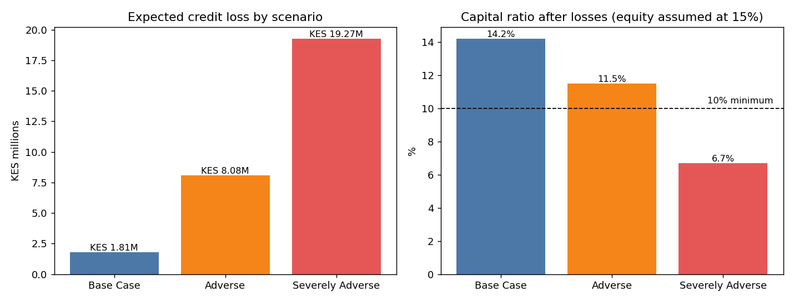
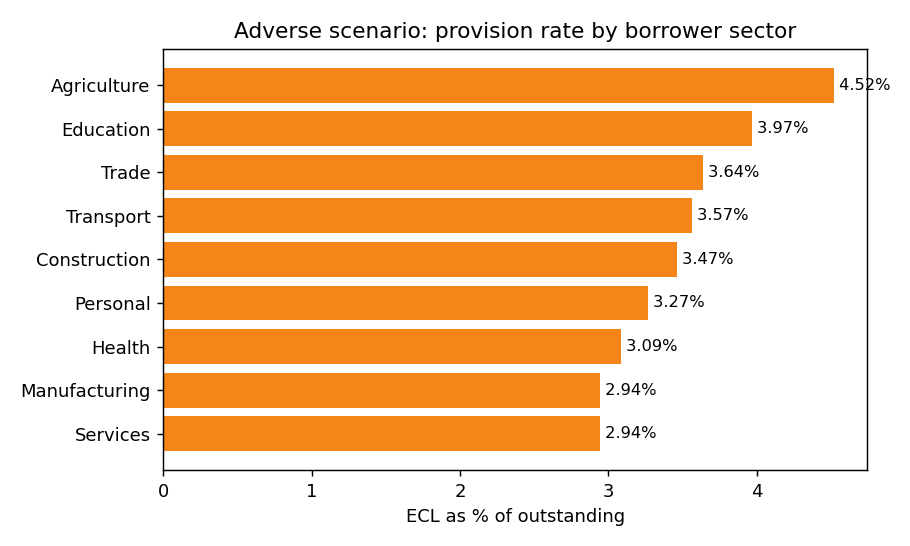

# SACCO Loan Portfolio Stress Test (IFRS 9 ECL)

A Python engine that stress-tests a Kenyan SACCO loan book under three macroeconomic scenarios and reports IFRS 9
expected credit loss (ECL) by stage, product and sector. On a 2,000-loan synthetic portfolio of KES 231.9M, ECL
rises from KES 1.81M in the base case to KES 19.27M under the severely adverse scenario, which takes the capital
ratio from 14.2% to 6.7%, KES 7.68M short of a 10% minimum.



## Results

| Scenario | Weight | Severity score | ECL | Provision rate | Capital ratio after losses |
|---|---|---|---|---|---|
| Base Case | 60% | 2.4 | KES 1.81M | 0.78% | 14.2% |
| Adverse | 30% | 27.1 | KES 8.08M | 3.49% | 11.5% |
| Severely Adverse | 10% | 57.0 | KES 19.27M | 8.31% | 6.7%, below the 10% minimum |
| Probability-weighted | | | KES 5.44M | 2.35% | |

The probability-weighted figure is the one IFRS 9 asks for: 60% of the base-case loss, 30% of the adverse and 10%
of the severe. Capital is the engine's stated assumption, equity equal to 15% of outstanding loans before losses;
the shortfall is the extra capital needed to stay at 10% after the severe loss. Every figure in this section is
written to `outputs/results.json` by `make_figures.py`.



Under the adverse scenario agriculture carries the highest provision rate (4.52% of outstanding), reflecting the
drought shock the scenario applies to farm incomes; services and manufacturing are lowest at 2.94%.

## How it works

1. **Portfolio.** `PortfolioGenerator` (seed 42) builds 2,000 loans across products, branches and nine borrower
   sectors, with loan size linked to income and interest rates set by product.
2. **Scenarios.** Base, Adverse and Severely Adverse set GDP growth (+5% to -1.5%), inflation (6.5% to 14%), the
   central bank rate (10% to 16%), unemployment, shilling depreciation (3% to 25%) and an agricultural shock (0% to
   -30%). Each scenario is summarised as a severity score.
3. **Migration and staging.** Monthly transition probabilities between performing, watch, substandard and default
   shift with severity; loans are then placed in IFRS 9 Stage 1, 2 or 3.
4. **Loss.** ECL = PD x LGD x EAD per loan. PD rises with severity, the borrower's loan-to-income ratio and the
   sector's exposure to the shock; LGD rises as collateral values are cut under stress; EAD is the outstanding
   balance.
5. **Reporting.** A console report and a four-sheet Excel workbook (executive summary, IFRS 9 staging, sector
   analysis, weighted ECL) in `output/`.

## What this result does not show

- **The portfolio is synthetic.** No real SACCO data is used; the loans come from a seeded generator, so the
  figures show how the engine behaves, not the condition of any real lender.
- **The transition probabilities and scenario parameters are illustrative assumptions** set by hand, not fitted
  to historical SACCO defaults or taken from a regulator's published scenarios.
- **Capital is an assumption.** Equity is taken as 15% of outstanding loans and the ratio uses loans, not
  risk-weighted assets, as the denominator, so the capital figures are a sensitivity, not a SASRA capital return.
- **EAD is the outstanding balance only**; undrawn commitments and prepayment are not modelled, and there is no
  discounting at the effective interest rate.

## How to run

```bash
git clone https://github.com/alvenyuka/SACCO-Stress-Test.git
cd SACCO-Stress-Test
pip install -r requirements.txt
python stress_test_engine.py   # console report and output/sacco_stress_test_report.xlsx
python make_figures.py         # outputs/results.json and the two charts above
```

On a Windows console, set `PYTHONIOENCODING=utf-8` first: the console report prints box-drawing characters.

## License

MIT. See [`LICENSE`](LICENSE).

Alven Yuka · [LinkedIn](https://www.linkedin.com/in/alven-yuka-610b78174/) · [Email](mailto:alvenyuka2@gmail.com)
